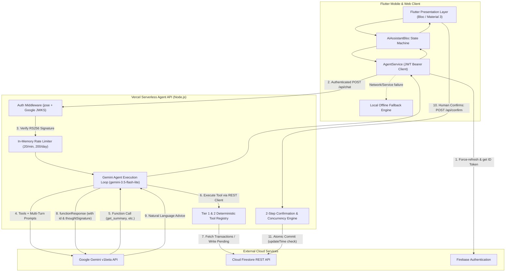

# 💎 ExpensePulse — AI Personal Finance Assistant

**FinTechathon 2026 Submission**  
**Topic A: Personal Finance Assistant**  
**Production Agent API:** [https://financial-advisor-ai-agent-api.vercel.app](https://financial-advisor-ai-agent-api.vercel.app)  

---

## 🌟 Overview

**ExpensePulse** is a personal finance management system combining deterministic expense tracking with an autonomous AI Financial Copilot. Architected specifically for high security and precision, ExpensePulse addresses the core hazard of generative AI in financial technology: **hallucination and unintended state modification**.

All mathematical computations (monthly totals, category breakdowns, savings rates, anomaly detection, and budget tracking) are computed by deterministic pure-code engines. The AI agent acts strictly as an intelligent interface that queries tools, explains insights conversationally in English or Bengali, and proposes budget limits through a strict **2-Step Human Confirmation State Machine**.

---

## 🚀 Key Features

- **Comprehensive Expense & Income Tracking:** Record multi-category transactions with amount validation, positive value bounds, and currency formatting in Bangladeshi Taka (৳) and USD ($).
- **Interactive Visual Analytics:** Real-time cashflow breakdowns, monthly moving averages, and category spending distribution.
- **Pulse AI Copilot (`agent-api`):** Deployed on Vercel Serverless, utilizing Google Gemini (`gemini-3.5-flash-lite`) with function calling to execute backend tools.
- **2-Step Human Confirmation (Tier 2 Actions):** The AI cannot modify budgets or savings goals directly. It drafts pending proposals with a 15-minute expiration that require explicit human approval via interactive cards.
- **Deterministic Math & Guard Rails:** Zero financial hallucination. Calculations are executed in JavaScript/Dart math routines, with prompt injection defense via `<data>` boundary tags and automated PII masking.
- **Offline High Availability Fallback:** If internet connectivity drops or the Gemini API is unreachable, an onboard deterministic rule engine seamlessly answers queries with local data.

---

## 🏗️ Architecture

ExpensePulse employs a clean **Client-Serverless Architecture**:



---

## 🛠️ Agent Tools & Permission Tiers

| Tool Name | Permission Tier | Execution Type | Description |
| :--- | :---: | :---: | :--- |
| `get_summary` | **Tier 1** | Auto (Read-Only) | Calculates monthly income, expenses, net savings, savings rate, and category breakdowns. |
| `get_transactions` | **Tier 1** | Auto (Read-Only) | Retrieves recent transactions with pagination and `<data>` tag prompt injection wrapping. |
| `find_unusual_spending` | **Tier 1** | Auto (Read-Only) | Detects spending spikes $\ge 1.5\times$ category historical mean and $\ge 500$ BDT. |
| `detect_recurring_bills` | **Tier 1** | Auto (Read-Only) | Groups historical expenses across $\ge 2$ months to detect subscriptions, bill amounts, and trends. |
| `analyze_bill` | **Tier 1** | Auto (Read-Only) | Computes month-by-month payment trends and percentage deltas for a specific vendor. |
| `forecast_next_month` | **Tier 1** | Auto (Read-Only) | Projects next month's estimated category expenditures using a 3-month moving average. |
| `propose_budget` | **Tier 1** | Auto (Read-Only) | Computes recommended 50/30/20 budget allocations from monthly income and category averages. |
| `get_budget_status` | **Tier 1** | Auto (Read-Only) | Evaluates current spending against active budgets, flagging 80% warnings and 100% over-budget alerts. |
| `create_budget` | **Tier 2** | **Human Confirmation** | Creates a `PENDING` proposal card. Commits to `budgets/` only after explicit user confirmation. |
| `create_savings_goal` | **Tier 2** | **Human Confirmation** | Creates a `PENDING` proposal card with monthly contribution math. Commits only upon user confirmation. |
| *Direct DB Deletion / Writes* | **Tier 3** | **Prohibited** | **Not Implemented.** Autonomous destructive writes are completely omitted by architecture to guarantee financial safety. |

---

## 🔒 Security Design

1. **Zero Client Secrets:** The Flutter app contains no LLM API keys or administrative service account credentials. All Gemini calls originate server-side within Vercel.
2. **Stateless RS256 JWT Verification:** Incoming requests are verified using Google's public JWKS certificates via `jose`. Document paths are derived strictly from token claims (`users/${email}_${uid}`), preventing Insecure Direct Object Reference (IDOR) attacks.
3. **Atomic State Machine & Anti-Replay:** Confirmations require `status === 'PENDING'` and use Firestore `currentDocument.updateTime` concurrency preconditions. Replay attempts are rejected with HTTP 409.
4. **Indirect Prompt Injection Defense:** All user transaction descriptions retrieved from storage are encapsulated in `<data>...</data>` boundary tags before LLM processing.
5. **Automated PII Masking:** Regex filters mask emails, phone numbers, and bank/card numbers before prompts leave the serverless environment.

---

## 💻 Tech Stack

- **Client App:** Flutter 3.x, Dart 3.x, BLoC Pattern (`flutter_bloc`), `dartz` (Functional Error Handling), `http`.
- **Backend API:** Node.js 20+, Vercel Serverless Functions (`agent-api/`).
- **AI Engine:** Google Gemini API (`gemini-3.5-flash-lite`, with single-retry fallback to `gemini-3.5-flash`).
- **Authentication:** Firebase Authentication (Email/Password, Google Sign-In).
- **Database:** Cloud Firestore (Native REST API with atomic preconditions).
- **Token Verification:** `jose` (RS256 JWT validation against Google JWKS).

---

## 📂 Project Structure

```
financial_advisor_ai/
├── agent-api/                       # Production Vercel Serverless Backend
│   ├── api/                         # HTTP Endpoints (chat.js, confirm.js, cancel.js, health.js)
│   ├── lib/                         # Core engines (gemini.js, tools.js, auth.js, db.js, ratelimit.js, guard.js)
│   ├── test/                        # Backend unit test suite (43 automated tests)
│   ├── scripts/                     # Verification test scripts (full_e2e_test.js, local_test.js)
│   └── vercel.json                  # Vercel deployment specification
├── lib/                             # Flutter Client Application
│   ├── core/                        # Services (agent_service.dart), constants (agent_config.dart), error models
│   └── features/                    # Feature-First BLoC modules (ai_assistant, transactions, auth, dashboard)
├── test/                            # Flutter test suite (37 automated tests)
├── docs/                            # Comprehensive Technical & Security Documentation
│   ├── TECHNICAL_DOCUMENTATION.md   # Architectural deep dive, data model, tool algorithms
│   ├── SECURITY_ASSESSMENT.md       # STRIDE threat model, controls table, risk mitigations
│   ├── TEST_CASES.md                # Full catalog of all 80 automated test cases
│   └── DEMO_SCRIPT.md               # Step-by-step judge presentation script
├── evidence/                        # Verification artifacts & test execution logs
│   ├── README.md                    # Screenshot placeholder checklist & reproduction guide
│   └── test_results.txt             # Verified test output (flutter analyze + flutter test + npm test)
├── functions/                       # Legacy Cloud Functions (Superseded by agent-api/)
└── firestore.rules                  # Security rules invariants
```

---

## ⚙️ Setup & Deployment

### 1. Backend (`agent-api/`) Deployment on Vercel
Deploy `agent-api/` to Vercel and configure the following **3 Environment Variables**:

| Variable Name | Description | Example Value |
| :--- | :--- | :--- |
| `GEMINI_API_KEY` | Google AI Studio Gemini API Key | `AIzaSy...` |
| `FIREBASE_PROJECT_ID` | Your Firebase Project ID | `pulse-expense-3156f` |
| `GEMINI_MODEL` | Active Gemini Model ID | `gemini-3.5-flash-lite` |

```bash
cd agent-api
npm install
npm test
# Deploy to Vercel:
vercel --prod
```

### 2. Client App Configuration
Ensure [`lib/core/constants/agent_config.dart`](lib/core/constants/agent_config.dart) points to your deployed Vercel backend:

```dart
class AgentConfig {
  static const String baseUrl = 'https://financial-advisor-ai-agent-api.vercel.app';
  static const String chatEndpoint = '/api/chat';
  static const String confirmEndpoint = '/api/confirm';
  static const String cancelEndpoint = '/api/cancel';
}
```

Run the Flutter client:
```bash
flutter pub get
flutter run -d chrome     # Or: flutter run -d android
```

---

## 🧪 Running Automated Tests

ExpensePulse includes **80 automated tests** covering the full stack:

```bash
# 1. Run Flutter static analysis (0 errors expected)
flutter analyze

# 2. Run Flutter test suite (37 tests, 100% pass)
flutter test

# 3. Run Agent API test suite (43 tests, 100% pass)
cd agent-api
npm test
```

Verification output is preserved in [`evidence/test_results.txt`](evidence/test_results.txt).

---

## 🎯 Demo Guide & Sample Prompts

To test the AI Assistant in the live app, navigate to the **AI Assistant** tab and try these verified sample prompts:

1. **Monthly Spending Summary:**
   > *"How am I spending this month?"*  
   *(Invokes `get_summary` and `get_budget_status` to show total income, expense, and savings rate in ৳).*

2. **Anomaly Detection:**
   > *"Did I have any unusual spending or spikes recently?"*  
   *(Invokes `find_unusual_spending` to calculate transactions exceeding $1.5\times$ historical mean).*

3. **Recurring Subscriptions:**
   > *"What recurring bills or subscriptions do I pay?"*  
   *(Invokes `detect_recurring_bills` across multi-month records).*

4. **Tier 2 Budget Proposal & Confirmation:**
   > *"Help me set a budget for Dining of 5000 Taka."*  
   *(Agent executes `create_budget`, generates a 15-minute pending proposal card with **Confirm** and **Cancel** buttons).*
   - Tap **"Confirm & Save"** $\rightarrow$ Sends authenticated request to `/api/confirm`, writes to `budgets/dining_&_food`, and appends an immutable audit log.

5. **Tier 2 Savings Goal Proposal:**
   > *"I want to save 60000 Taka for Emergency Fund in 12 months."*  
   *(Agent executes `create_savings_goal`, calculates ৳5000/month contribution, and displays authorization card).*

---

## ⚠️ Known Limitations

In the interest of full transparency and competition integrity:
1. **Client-Writable Audit Logs by Account Owner:** In [`firestore.rules`](firestore.rules), the `audit_logs` collection permits the authenticated user who owns the document path to `create` documents (while strictly denying `update` and `delete`). A technical user with their own token could insert custom records. Audit logs generated by the agent are tagged with `writtenViaAgentApi: true`.
2. **Best-Effort In-Memory Rate Limiting:** The rate limiter in `agent-api/lib/ratelimit.js` tracks request windows in memory per serverless execution instance. In serverless environments with high horizontal scaling, rate limits are enforced per-instance rather than globally.
3. **Firestore Security Rules Deployment:** Security rules in `firestore.rules` are verified via comprehensive simulation tests (`firestore_rules_simulation_test.dart`), but live rules in the Firebase console must be published via Firebase CLI before full production launch.

---

## 🔮 Future Scope

- **Global Redis Rate Limiter:** Upgrade the in-memory sliding window limiter to Upstash Redis for multi-region synchronized rate limits.
- **Automated Receipt OCR:** Integrate Gemini multimodal image analysis for direct camera receipt scanning and automatic transaction logging.
- **Bank Statement Parsing:** Secure CSV/OFX statement parsing to import historical transactions into Firestore.
- **Predictive Cashflow Alerts:** Scheduled push notifications warning users 48 hours in advance of expected recurring utility bills.

---

## 👥 Authors & Competition Submission

- **Developed for:** FinTechathon 2026 (Topic A: Personal Finance Assistant)
- **Repository:** [https://github.com/zahidul-islam-zisan/financial-advisor-ai-agent](https://github.com/zahidul-islam-zisan/financial-advisor-ai-agent)
- **License:** MIT License
