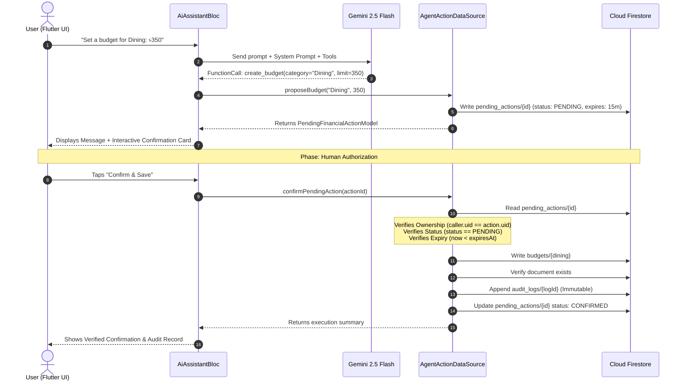

# 📘 ExpensePulse — Technical & Architectural Documentation

## 1. System Architecture
ExpensePulse follows a **Feature-First Clean Architecture** with distinct presentation, business logic, and data layers:
- **Presentation Layer:** Flutter Widgets and BLoC Consumers.
- **State Management:** BLoC Pattern (`flutter_bloc ^9.1.1`).
- **Domain/Data Layer:** Repositories and Data Sources utilizing functional error handling (`dartz Either<Failure, T>`).
- **Backend Services:** Firebase Authentication, Cloud Firestore, and Google Gemini 2.5 Flash (with offline deterministic fallback).

---

## 2. Agent & Tool Execution Flow

---

## 3. Approved Tools Specification

### `get_summary(month)`
- **Input:** `month` (optional string, format `YYYY-MM`). Defaults to current month.
- **Deterministic Logic:**
  - Queries `users/{docId}/income_expenses` where `date >= startOfMonth` and `date < endOfMonth`.
  - Calculates:
    $$\text{Net Savings} = \text{Total Income} - \text{Total Expenses}$$
    $$\text{Savings Rate} = \begin{cases} \left(\frac{\text{Net Savings}}{\text{Total Income}}\right) \times 100 & \text{if Total Income} > 0 \\ 0 & \text{otherwise} \end{cases}$$
  - Category breakdown:
    $$\text{Category \%} = \begin{cases} \left(\frac{\text{Category Expense}}{\text{Total Expenses}}\right) \times 100 & \text{if Total Expenses} > 0 \\ 0 & \text{otherwise} \end{cases}$$

### `find_unusual_spending()`
- **Deterministic Anomaly Detection Algorithm:**
  - Aggregates the last 50 expense transactions by category.
  - Computes the historical arithmetic mean for each category:
    $$\mu_{\text{category}} = \frac{1}{N}\sum_{i=1}^{N} \text{Amount}_i$$
  - Flags any transaction where $\text{Amount} \ge 1.5 \times \mu_{\text{category}}$ and $\text{Amount} > 20.0$.

### `create_budget(category, limit)` & `create_savings_goal(name, target, months)`
- **2-Step Confirmation Guarantee:** Enforces that no database writes occur until a user explicitly confirms the proposed action.
- Uses idempotent document IDs (`category.toLowerCase().replaceAll(' ', '_')`) to prevent duplicate records.

---

## 4. Security Design & Guarantees

1. **Authentication:** All actions require a non-null `request.auth.uid`.
2. **Authorization:** Every document path begins with `users/{docId}` where `docId == "${email}_${uid}"`. Cross-user access is blocked.
3. **Anti-Replay Protection:** Re-executing a confirmed action is blocked by checking `status == 'PENDING'`. Once marked `CONFIRMED`, `REJECTED`, or `EXPIRED`, duplicate execution is rejected.
4. **Expiry Enforcement:** Pending actions are valid for 15 minutes. Expired actions are rejected.
5. **Audit Trail Integrity:** Actions append records with timestamp, status, actionId, and parameter snapshots.
   - *Client SDK / Rules Tier:* `firestore.rules` enforces `allow update, delete: if false;`, ensuring existing logs cannot be edited or deleted by clients.
   - *Backend Cloud Functions Tier:* Staged in `functions/index.js`, where write access is restricted exclusively to trusted server code with `verifiedByServer: true`, preventing client fabrication.

---

## 5. Testing & Verification Classification

To maintain scientific rigor and transparency, tests in ExpensePulse are categorized as follows:

| Test Category | Execution Mechanism | Scope & Coverage |
| :--- | :--- | :--- |
| **Automated Unit & State Tests** | `flutter test` (22 Passing Tests) | Verifies model serialization, removal of plaintext passwords, financial math (totals, savings rate, 50/30/20 rule), boundary checks, prompt injection containment, confirmation lifecycle, and Firestore rule invariants. |
| **Firestore Security Rules Tests** | `test/firestore_rules_simulation_test.dart` | Tests rule invariants: owner validation, cross-user denial, password injection prevention, positive amount enforcement, and append-only audit logs. |
| **Local Emulator Suite** | `firebase.json` (Ports 8080, 9099, 5001, 4000) | Pre-configured emulator suite allowing local Firestore, Auth, and Functions execution without connecting to production. |
| **Offline Deterministic Fallback** | `AiRemoteDataSource` rule engine | Provides instant, zero-latency financial analysis and tool proposal when no Gemini API key is configured or when offline. |
| **Live AI Integration** | Google AI Studio (`gemini-2.5-flash`) | Supports runtime API key configuration for live natural language conversation and function calling. |

---

## 6. Cloud Functions & Billing Requirements

- **Free Spark Plan (Current Working Setup):** The application runs out of the box on Firebase Spark (free tier). The client Flutter app communicates directly with Firestore and Auth under strict security rules, utilizing the local offline engine or direct Gemini API.
- **Blaze Plan (Pay-as-you-go) Requirement:** Deploying Firebase Cloud Functions (`functions/index.js`) to production requires upgrading the Firebase project to the **Blaze plan**.
- **Secret Manager:** Once upgraded, the Gemini API key is securely stored in Google Cloud Secret Manager (`GEMINI_API_KEY`) and accessed only by Cloud Functions backend code. No client-side key storage is required in this tier.

