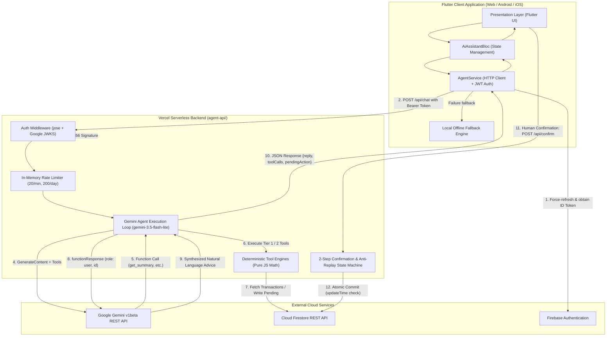
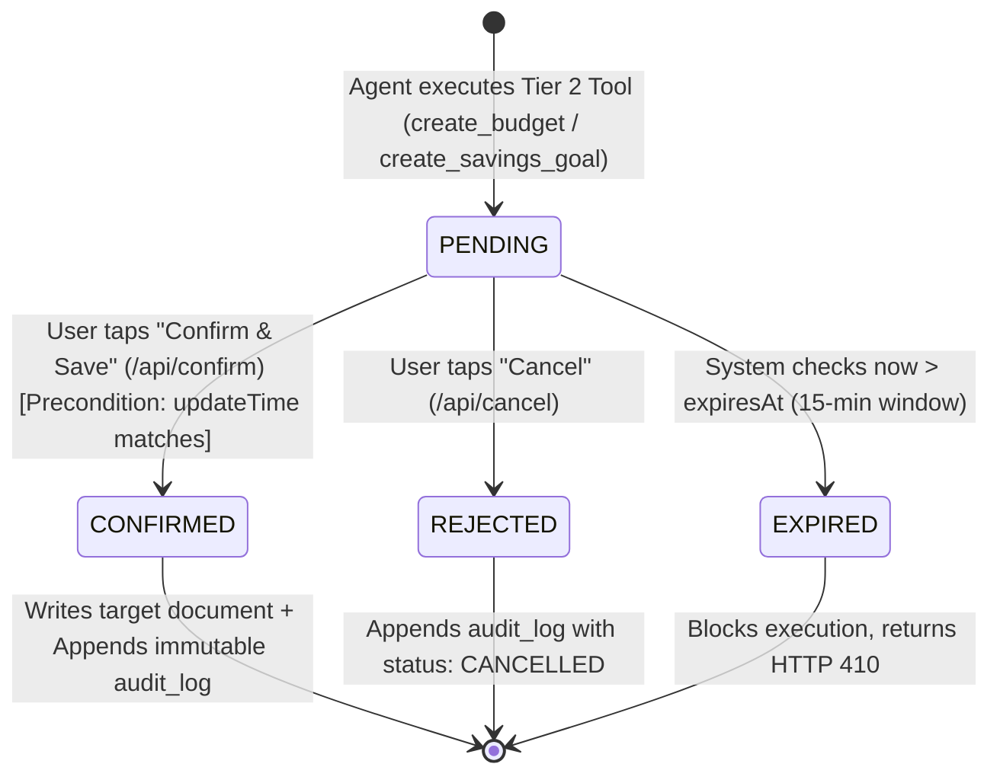

# 📘 ExpensePulse — Technical & System Architecture Documentation

**FinTechathon 2026 Submission (Topic A: Personal Finance Assistant)**  
**Version:** 2.0.0 (Production Serverless Agent Architecture)  
**Date:** October 2026  

---

## 1. System Architecture

ExpensePulse implements a **Hybrid Edge-Serverless Architecture** that separates the client application presentation layer from the AI reasoning engine and database operations.



---

## 2. End-to-End Request Flow

### A. Chat Endpoint (`POST /api/chat`)
1. **Token Acquisition:** Flutter's `AgentService` retrieves the user's current Firebase ID Token via `FirebaseAuth.instance.currentUser?.getIdToken()`.
2. **CORS & Method Validation:** `handleCors(req, res)` processes `OPTIONS` preflight requests (returning HTTP 204). Non-POST methods are rejected with HTTP 405.
3. **Authentication Verification (`lib/auth.js`):**
   - Extracts the `Bearer <token>` string from the `Authorization` header.
   - Dynamically imports `jose` and verifies the RS256 token against Google's public JWKS endpoint:
     `https://www.googleapis.com/service_accounts/v1/jwk/securetoken@system.gserviceaccount.com`.
   - Validates that `issuer === 'https://securetoken.google.com/<projectId>'` and `audience === projectId`.
   - Extracts `uid` and `email` to construct the canonical document path: `${email.toLowerCase()}_${uid}`.
4. **Rate Limit Gate (`lib/ratelimit.js`):**
   - Enforces a sliding window per `uid`: maximum **20 requests per minute** and **200 requests per day**.
   - If exceeded, returns HTTP 429 with a `Retry-After: 60` header.
5. **Request Sanitization & Multi-Turn Normalization (`lib/gemini.js`):**
   - Validates message length ($\le 1000$ characters).
   - Sanitizes and masks PII (emails, phone numbers, credit card numbers) using `maskPii()`.
   - Normalizes conversation turns ensuring the first turn is `role: "user"` and turns strictly alternate (`user -> model -> user -> model`).
6. **Gemini Agent Execution Loop:**
   - Calls Google Gemini REST API (`https://generativelanguage.googleapis.com/v1beta/models/<model>:generateContent`) using the `x-goog-api-key` header (never in the URL query string).
   - If Gemini returns one or more `functionCall` items:
     - Tier 1 tools execute deterministically via `executeTier1Tool()` and query Firestore REST.
     - Tier 2 proposal tools create a `PENDING` action document in `users/{docId}/pending_actions/{actionId}` with a 15-minute expiration.
     - The exact model candidate content turn is preserved (retaining `thoughtSignature` and `id` fields).
     - A user turn containing `functionResponse` for each called tool is appended and sent back to Gemini.
   - Gemini synthesizes the final advice, appending the mandatory disclaimer:
     > *"This is a suggestion, not professional financial advice."*
7. **Client Delivery:** Returns `{ reply, toolCalls, pendingAction, isOffline, offlineReason }` to the client.

### B. Confirmation Endpoint (`POST /api/confirm`)
1. User reviews the interactive proposal card in Flutter and taps **"Confirm & Save"**.
2. Client sends `POST /api/confirm` with `{ actionId }` and the Bearer token.
3. Server authenticates token and fetches `users/{docId}/pending_actions/{actionId}` from Firestore REST.
4. State Machine enforces:
   - **Ownership:** `action.uid === auth.uid` (returns HTTP 403 on mismatch).
   - **Anti-Replay:** `action.status === 'PENDING'` (returns HTTP 409 Conflict if already processed).
   - **Expiration:** `Date.now() <= expiresAt` (returns HTTP 410 Expired if timed out).
5. Executes an **Atomic Commit** via Firestore REST with `currentDocument.updateTime` precondition:
   - Target document created (e.g., `users/{docId}/budgets/{slug}` or `savings_goals/{goalId}`).
   - Pending action updated to `status: "CONFIRMED"`, `executedAt: <now>`, `auditLogId: <logId>`.
   - Immutable audit log written to `users/{docId}/audit_logs/{logId}` with `writtenViaAgentApi: true`.
6. Returns HTTP 200 with execution summary.

---

## 3. Cloud Firestore Data Model

All user data is strictly scoped under the authenticated user's document identifier (`users/{email}_{uid}`):

```
users/
└── {email}_{uid}/
    ├── profile: { name, email, currency: "BDT", createdAt }
    ├── income_expenses/
    │   └── {transactionId}/
    │       ├── id: string
    │       ├── amount: number (positive double)
    │       ├── isIncome: boolean
    │       ├── category_name: string (e.g. "Dining & Food")
    │       ├── category_id: string
    │       ├── date: string (YYYY-MM-DD)
    │       ├── time: string (HH:mm)
    │       ├── description: string (wrapped in <data>...</data>)
    │       └── createdAt: timestamp
    ├── budgets/
    │   └── {category_slug}/  (e.g. "dining_&_food")
    │       ├── category: string
    │       ├── limit: number (monthly cap in BDT)
    │       ├── createdAt: timestamp
    │       └── updatedAt: timestamp
    ├── savings_goals/
    │   └── {goalId}/
    │       ├── id: string (UUIDv4)
    │       ├── goalName: string
    │       ├── targetAmount: number
    │       ├── targetMonths: number
    │       ├── monthlyContribution: number (targetAmount / targetMonths)
    │       ├── currentSaved: number (default 0.0)
    │       └── createdAt: timestamp
    ├── pending_actions/
    │   └── {actionId}/
    │       ├── id: string (UUIDv4)
    │       ├── uid: string
    │       ├── docId: string
    │       ├── actionType: "CREATE_BUDGET" | "CREATE_SAVINGS_GOAL"
    │       ├── title: string
    │       ├── parameters: map
    │       ├── status: "PENDING" | "CONFIRMED" | "REJECTED" | "EXPIRED"
    │       ├── createdAt: timestamp
    │       ├── expiresAt: timestamp (createdAt + 15 min)
    │       ├── executedAt?: timestamp
    │       └── auditLogId?: string
    └── audit_logs/
        └── {logId}/
            ├── id: string (UUIDv4)
            ├── uid: string
            ├── docId: string
            ├── actionId: string | null
            ├── actionType: string
            ├── status: "SUCCESS" | "CANCELLED" | "FAILED"
            ├── summary: string
            ├── details: map
            ├── timestamp: timestamp
            └── writtenViaAgentApi: boolean
```

---

## 4. Approved Agent Tools & Mathematical Specifications

All financial computations are performed deterministically in JavaScript/Dart. The LLM is strictly prohibited from inventing or approximating numbers.

### Tier 1: Read-Only Analysis Tools (Auto-Executed)

#### 1. `get_summary(month?)`
- **Purpose:** Computes comprehensive monthly financial metrics.
- **Formulas:**
  $$\text{Net Savings} = \text{Total Income} - \text{Total Expense}$$
  $$\text{Savings Rate} = \begin{cases} \left(\frac{\text{Net Savings}}{\text{Total Income}}\right) \times 100 & \text{if Total Income} > 0 \\ 0.0 & \text{otherwise} \end{cases}$$
  $$\text{Category Breakdown}[c] = \sum_{t \in \text{Expenses}_c} t.\text{amount}$$

#### 2. `get_transactions(month?, category?, limit?)`
- **Purpose:** Retrieves transaction history with safe pagination (capped at 50) and wraps descriptions in `<data>...</data>` tags to prevent indirect prompt injection.

#### 3. `find_unusual_spending(month?)`
- **Purpose:** Detects anomalous spending spikes compared to historical category averages.
- **Algorithm:**
  - Evaluates categories with at least 3 historical expense samples.
  - Computes arithmetic mean: $\bar{x} = \frac{1}{N}\sum_{i=1}^{N} x_i$.
  - Anomaly criteria: $\text{Amount} \ge 1.5 \times \bar{x}$ AND $\text{Amount} \ge 500\text{ BDT}$.
  - Computes spike ratio: $R = \frac{\text{Amount}}{\bar{x}}$, sorted descending.

#### 4. `detect_recurring_bills(minMonths?)`
- **Purpose:** Automatically identifies recurring subscriptions and utility obligations.
- **Algorithm:**
  - Normalizes transaction descriptions (lowercased, stripped of digits and punctuation).
  - Requires occurrences across $\ge 2$ distinct calendar months.
  - Computes typical day of month: $\text{Day} = \text{round}\left(\frac{1}{N}\sum d_i\right)$.
  - Calculates trend percentage: $\text{Trend} = \frac{A_{\text{latest}} - A_{\text{prev}}}{A_{\text{prev}}} \times 100$.
  - Projects next expected billing date.

#### 5. `analyze_bill(title)`
- **Purpose:** Month-by-month trajectory analysis of a specific vendor or utility.
- **Algorithm:** Filters expenses matching query title and computes month-over-month delta percentages.

#### 6. `forecast_next_month(category?)`
- **Purpose:** Expense projection based on a 3-month moving average.
- **Formula:**
  $$\hat{E}_{c} = \frac{1}{M}\sum_{m=1}^{M} E_{c, m} \quad (M \le 3)$$

#### 7. `propose_budget(targetSavingsRate?)`
- **Purpose:** Generates recommended category budget caps utilizing the classical 50/30/20 financial rule.
- **Allocations:**
  - Needs Cap: $50\%$ of average monthly income (Housing, Groceries, Utilities, Health, Transport).
  - Wants Cap: $30\%$ of average monthly income (Dining, Shopping, Entertainment).
  - Target Savings: $20\%$ of average monthly income.

#### 8. `get_budget_status(month?)`
- **Purpose:** Evaluates current-month spending against established budget caps.
- **Alert Logic:**
  - Near Limit Alert: $80\% \le \frac{\text{Spent}}{\text{Limit}} < 100\%$.
  - Over Budget Alert: $\frac{\text{Spent}}{\text{Limit}} \ge 100\%$.

---

### Tier 2: Proposal Tools (Requires 2-Step Human Confirmation)

#### 9. `create_budget(category, limit)`
- **Constraints:** `category` must be non-empty string; `limit` must be a positive number $> 0$.
- **Behavior:** Never writes to `budgets/`. Creates a `PENDING` action record and returns a proposal card to the user.

#### 10. `create_savings_goal(goalName, targetAmount, targetMonths)`
- **Constraints:** `targetAmount > 0`, `1 <= targetMonths <= 120`.
- **Formulas:**
  $$\text{Monthly Contribution} = \text{round}\left(\frac{\text{Target Amount}}{\text{Target Months}}, 2\right)$$
- **Behavior:** Creates a `PENDING` action record for user authorization.

---

## 5. 2-Step Confirmation State Machine



- **Precondition Concurrency Defense:** All confirmation commits pass Firestore's `currentDocument: { updateTime: pendingDoc.updateTime }`. If a concurrent request or replay attempt occurs, Firestore rejects the commit with an HTTP 409 precondition failure.

---

## 6. Error Handling & Deterministic Offline Fallback

ExpensePulse guarantees high availability through a multi-tiered fallback architecture:

1. **Transient Network or Rate Limit Failures:**
   - On HTTP 404 (model unavailable), the agent retries once with the configured fallback model (`gemini-3.5-flash`).
   - On HTTP 429 or 503, the agent retries once with the fallback model.
2. **Offline Rule Engine Fallback:**
   - If the device is disconnected, or the Gemini API is unreachable, the client and server activate an internal **deterministic offline rule engine**.
   - The engine parses intent via rule-matching keywords and directly executes the appropriate Tier 1 analytical calculation against local data.
   - The response includes `"isOffline": true` and an explicit `offlineReason` (`"missing_key"`, `"http_400"`, `"http_429"`, `"timeout"`, etc.), preserving full transparency for the user.
